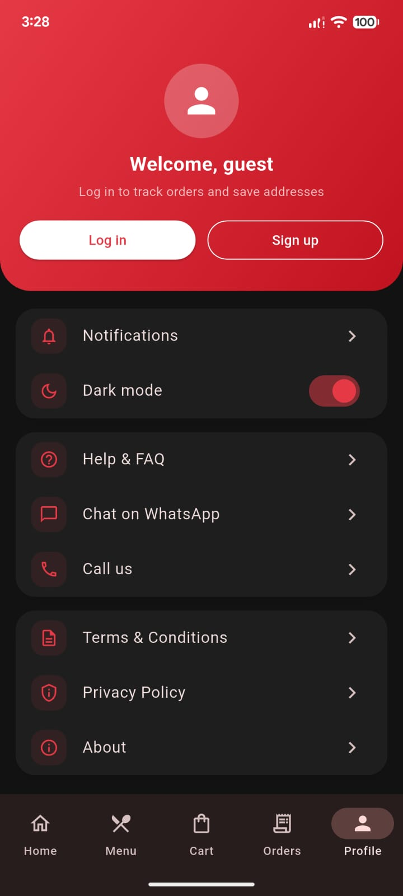
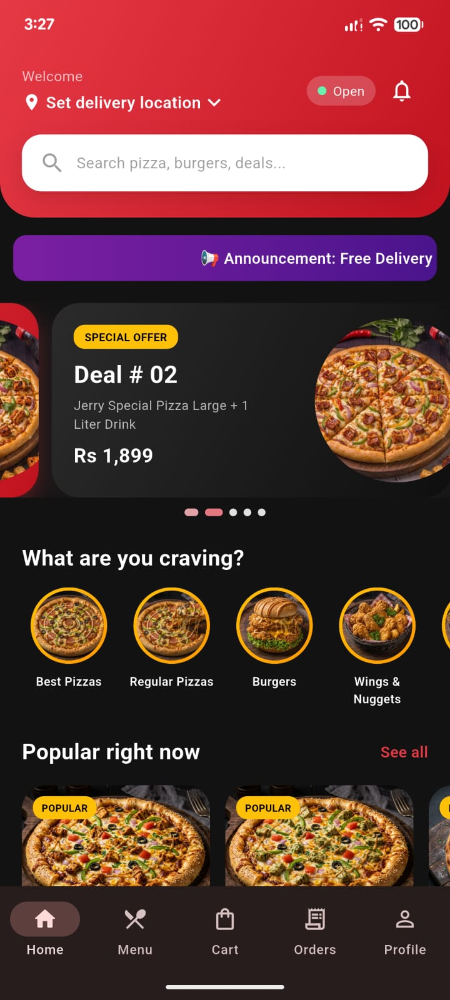
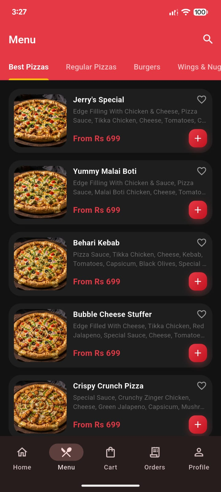
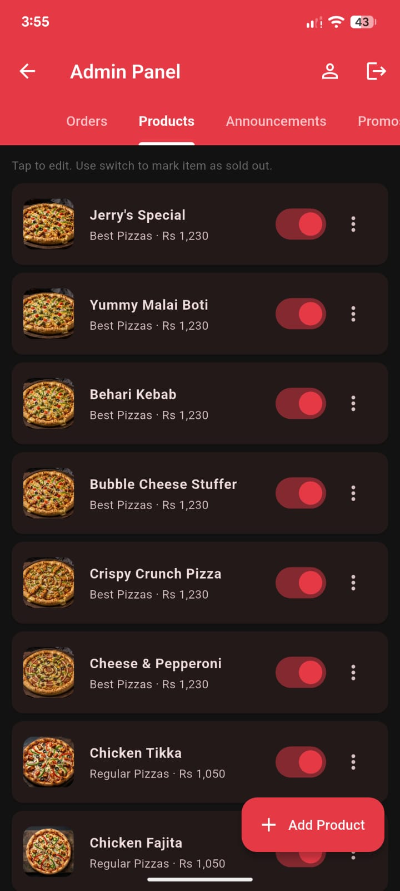
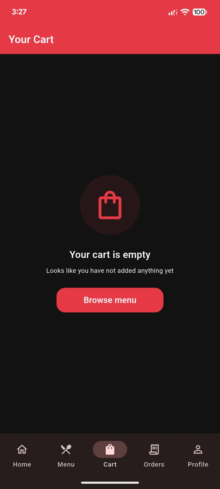
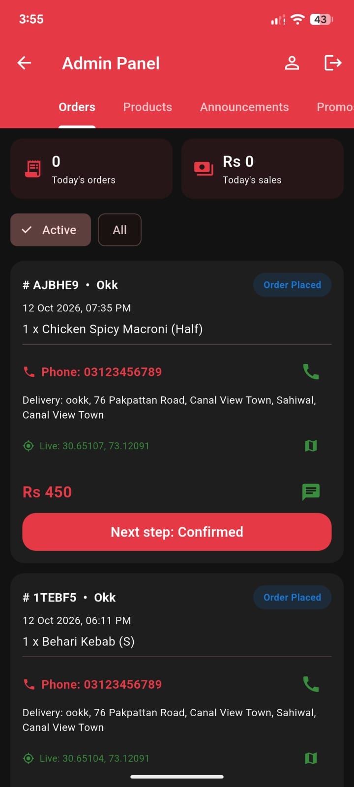

# Jerry Pizza & Chicken Karrahi

A complete food ordering solution for Jerry Pizza & Chicken Karrahi — built with Flutter & Firebase.

---

## About

**Jerry Pizza & Chicken Karrahi** is a full-stack food ordering application designed for a local restaurant in Sahiwal, Pakistan. It provides a seamless digital ordering experience for customers and a complete management system for the restaurant admin.

---

## Features

### For Customers

- Browse menu by categories (Pizzas, Burgers, Wraps, Desi, etc.)
- Real-time cart and checkout
- Live location-based delivery
- Order tracking with real-time status updates
- Free delivery on Rs 1000+ orders within 1 km
- Cash on Delivery
- Order history and one-tap reorder
- Favorites management
- Light and Dark mode support

### For Admin

- Complete order management system
- Real-time order notifications with unread badge
- Customer live location and contact details
- Product management (Add / Edit / Delete / Sold Out)
- Announcement system (moving banner on home)
- Promo codes management
- Restaurant settings (delivery fee, radius, hours)
- User management

---

## Screenshots

### Login

### Home Screen

### Menu

### Product Detail

### Cart

### Admin Panel

---

## Tech Stack

| Technology | Purpose |
|------------|---------|
| Flutter | Cross-platform mobile and web |
| Firebase Auth | User authentication |
| Cloud Firestore | Real-time database |
| Firebase Hosting | Web deployment |
| Firebase Crashlytics | Crash reporting |
| Firebase Cloud Messaging | Push notifications |
| Riverpod | State management |
| Go Router | Navigation |
| Google Maps | Location picker |
| Geolocator | Distance calculation |
| Cached Network Image | Image caching |
| Shared Preferences | Local storage |

---

## Requirements

- Flutter SDK: 3.10.7 or above
- Dart SDK: 3.0.0 or above
- Android SDK: API 24+
- Java: JDK 17
- Firebase project

---

## Installation

### 1. Clone the repository

    git clone https://github.com/noumannadir595/jerrypizza.git
    cd jerrypizza

### 2. Install dependencies

    flutter pub get

### 3. Firebase setup

1. Create a Firebase project at [console.firebase.google.com](https://console.firebase.google.com)
2. Enable Authentication (Email/Password)
3. Enable Cloud Firestore
4. Add Android app with package `com.jerrypizza.app`
5. Download `google-services.json` and place it in `android/app/`
6. Add SHA-1 fingerprint in Firebase Console

### 4. Google Maps setup

1. Get an API key from [Google Cloud Console](https://console.cloud.google.com)
2. Enable Maps SDK for Android and Geocoding API
3. Add the key to `android/app/src/main/AndroidManifest.xml`

### 5. Run the app

    flutter run

---

## Project Structure

    jerrypizza/
    ├── android/              # Android-specific files
    ├── ios/                  # iOS-specific files
    ├── web/                  # Web-specific files
    ├── assets/
    │   ├── icons/            # App icons
    │   ├── images/           # Product images
    │   │   ├── categories/
    │   │   ├── best_pizza/
    │   │   ├── regular_pizza/
    │   │   ├── burger/
    │   │   ├── wings_nuggets/
    │   │   ├── wraps/
    │   │   ├── fries/
    │   │   ├── pasta/
    │   │   ├── sandwich/
    │   │   ├── new_arrival/
    │   │   ├── drinks/
    │   │   ├── deals/
    │   │   └── desi/
    │   └── fonts/            # Poppins font family
    ├── lib/
    │   ├── admin.dart        # Admin panel
    │   ├── config.dart       # App configuration
    │   ├── firebase_options.dart
    │   ├── main.dart         # App entry point
    │   ├── menu_data.dart    # Hardcoded menu data
    │   ├── models.dart       # Data models
    │   ├── providers.dart    # Riverpod providers
    │   ├── router.dart       # Go Router routes
    │   ├── services.dart     # Firebase and location services
    │   ├── widgets.dart      # Reusable widgets
    │   └── screens/
    │       ├── auth_screens.dart
    │       ├── home_screens.dart
    │       ├── location_screens.dart
    │       ├── order_screens.dart
    │       └── profile_screens.dart
    └── pubspec.yaml

---

## App Flow

### Customer Flow

    Splash -> Onboarding -> Login/Signup -> Home
                                              |
                                    [Announcement banner]
                                    [Promo carousel]
                                    [Categories]
                                    [Popular items]
                                    [Value deals]
                                              |
                                    Menu -> Product -> Cart -> Checkout -> Order

### Admin Flow

    Login -> "Login as Admin" -> Admin Login Page
                                       |
                               Admin Dashboard
                                       |
                        [Orders] [Products] [Announcements]
                        [Promos] [Notify] [Settings] [Users]
                                       |
                            Profile: Change email/password

---

## Design System

### Colors

- Primary: #E63946 (Red)
- Accent: #FFC107 (Yellow)
- Success: #388E3C (Green)
- Error: #D32F2F (Dark Red)

### Typography

- Font Family: Poppins
- Weights: Regular (400), Medium (500), SemiBold (600), Bold (700)

---

## Security

- Firebase Security Rules enforce admin-only access for sensitive operations
- Admin email configured in `config.dart`
- Sensitive files (keystore, google-services.json) are gitignored

---

## License

This project is proprietary software built for Jerry Pizza & Chicken Karrahi.

Copyright 2026 Nouman Nadir. All rights reserved.

---

## Developer

**Nouman Nadir**

- Email: [noumannadir595@gmail.com](mailto:noumannadir595@gmail.com)

---

If you like this project, please give it a star.